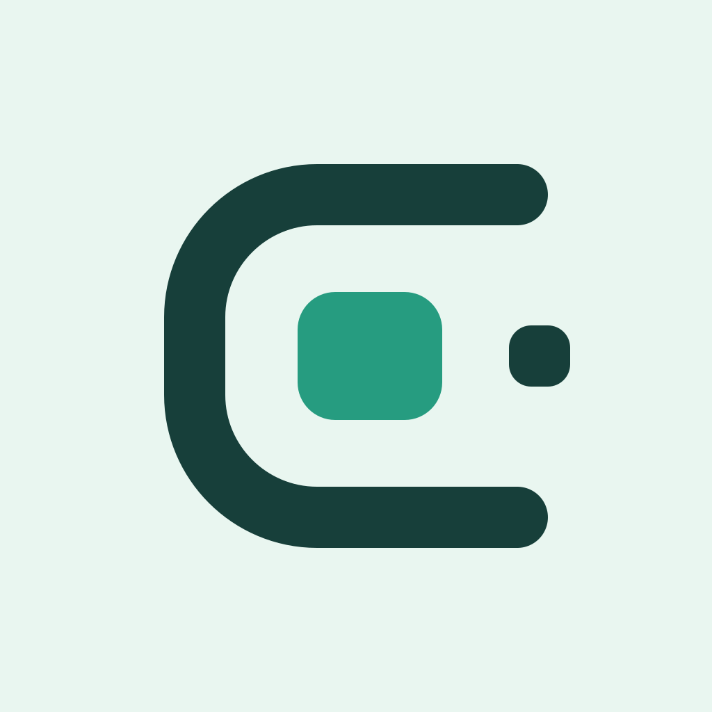

# 栖核 CoreNest



让设备与服务，各归其位。

面向自托管开发板的原生控制台，**iOS 0.4.0 / Server 0.3.1 开发预览**。本仓库维护两个组件：

- **CoreNest Server**：Docker API、限时配对网页和低权限主板指标桥。
- **CoreNest iOS**：SwiftUI 原生应用，iOS 26 使用系统 Liquid Glass 标签栏，旧系统保留原生标签栏。

[部署与扫码](docs/DOCKER_PAIRING.md) · [品牌设计](docs/BRAND.md) · [安全](SECURITY.md) · [维护](CONTRIBUTING.md) · [验收边界](VERIFICATION.md)

## 部署与扫码

先配置自己的 SSH 别名、HTTPS API 域名和接入认证，不要将真实值写入源码。以下 `board` 是操作者自行配置的 SSH 别名，`example.com` 是占位域名：

```powershell
python tools/deploy_docker.py --ssh board --endpoint https://board.example.com
```

传送白名单源码 → 远程终端由操作者完成 sudo → 启动 Docker → 检查 HTTPS → 建立本机 SSH 转发 → 在**运行部署器的电脑**打开二维码网页。已有安装只需：

```powershell
python tools/pair_device.py --ssh board --endpoint https://board.example.com
```

iPhone「绑定 → 扫码绑定」→ 确认域名 → 核对两端六位码 → 浏览器批准。只提供扫码配置，不要求手机手填地址或令牌。二维码五分钟过期，不携带长期 API/Cloudflare 密钥。每台手机本地生成独立 Token，服务端仅保存摘要，可分别撤销，重启保留绑定，默认只读。

无桌面主板不能直接打开远方电脑的浏览器。HTTPS、网络穿透和 Cloudflare Access 必须单独配置；二维码不会自动绕过 Access。尚无手机专用接入时不能关闭网关来掩盖配置缺失。

0.3.1 增加可选 Access 安全交接：操作者先向 Cloudflare 签发限时 bootstrap 与该手机独立的设备服务凭据，通过 `pairing.py create --access-stdin` 从私有 stdin 输入。二维码仅携带短期 bootstrap；浏览器批准后才经 HTTPS 交付长期手机凭据，首次成功 API 访问后清除服务端临时副本。Cloudflare 管理令牌不得部署到主板。此模式需要操作者配置签发流程，默认通用部署器不会自行管理 Cloudflare 账户。

## 功能与权限

- 三个原生标签：概览、服务、绑定。iOS 26 保留系统 Liquid Glass，关闭滚动缩放，避免导航尺寸跳变；网络详情从概览进入。
- CPU、内存、根分区、温度、网速、运行时间；没有实测值的功耗、转速不展示占位卡。
- 固定的 systemd 服务状态与最小化网络健康状态，不包含实际认证账号。
- 服务行可进入状态详情，显示实际系统单元与采样时间，支持前台自动/手动刷新；只读连接不显示启停按钮，未接入的日志入口不展示。这不是 Docker 容器管理器。
- 明确的演示模式，示例数字不代表实际设备测量。仅前台刷新，断线保留数据并标记过期。
- 正常 TLS 校验、拒绝凭据重定向，本机 Keychain 存储，不同步 iCloud，不上传相机帧。
- Docker 非 root、只读文件系统、禁止提权，不挂载 Docker socket 或私人认证目录。
- 控制默认关闭；当前 Docker 版不通过获取宿主机 root 权限来开启控制/日志。

## 云端构建

仓库 Actions 中的 **Build CoreNest unsigned IPA** 运行后端测试、iOS 新旧系统模拟器测试、真实截图，以及 ARM64/AMD64 容器配对与重启测试。产物包括：

- `CoreNest-unsigned-ipa`：ARM64 iPhoneOS 未签 IPA、SHA256 与清单，需自行有效签名后才能安装。
- `CoreNest-Docker-arm64` / `CoreNest-Docker-amd64`：可导入镜像及 SHA256。
- 模拟器截图与测试记录：仅使用通用演示数据，不读取真实设备凭据。

云端不得携带真实设备地址、个人账号、私人网络配置、本机路径或私有部署报告。构建通过不等于真实环境联网、散热、长期开机和安全审计通过。

## 工程入口

```text
ios/                      SwiftUI、Keychain、原生扫码、XCTest
backend/                  API、配对、只读采集桥、安全回归测试
deploy/                   通用安装文件
tools/                    构建、测试、打包、桌面部署、隐私检查
Dockerfile / compose.yaml
```

```powershell
python -m venv .venv
.venv\Scripts\python.exe -m pip install -r backend\requirements.txt
.venv\Scripts\python.exe -m unittest discover -s backend\tests -v
.venv\Scripts\python.exe backend\verify_http.py
python tools/verify_sources.py
python tools/privacy_check.py
```

Mac 使用 Xcode 26.3 打开 `ios/Cubie.xcodeproj`，选择 `Cubie` scheme。通用示例 Bundle ID 为 `org.corenest.app`，签名时使用自己的标识。项目不内置 Apple 证书、描述文件或私有服务凭据。

## 隐私约定

只提交通用源码、脱敏示例和可复现测试。真实配置从运行时输入、钥匙串或部署环境的私有文件取得，不进入代码、文档、fixture、截图、日志和镜像。不要提交配对地址栏、实际二维码或完整认证日志。

实际设备记录和本地专用安装工具不纳入版本控制。上传前运行隐私检查；`.gitignore` 不会清除历史提交，发现历史信息时需单独处理历史与构建产物。
